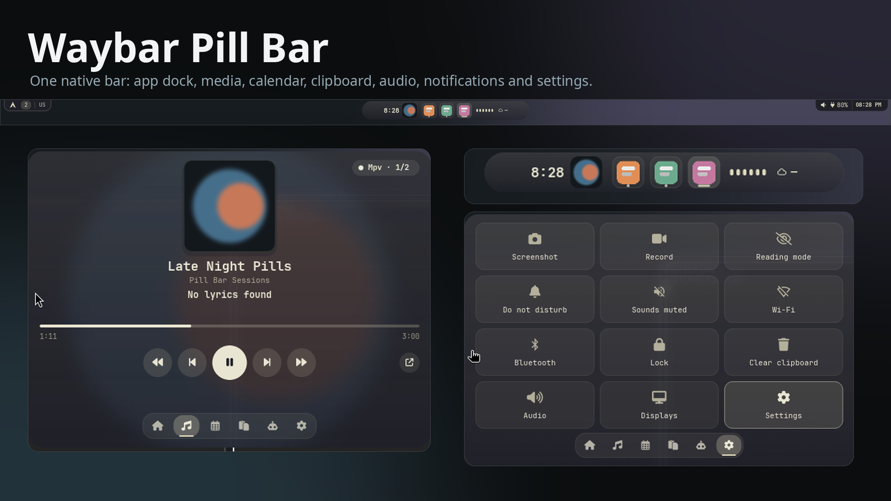
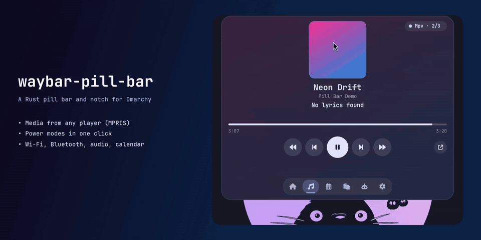

# waybar-pill-bar

A pure-Rust pill bar and notch (no GTK, no Waybar) for **Arch Linux + Omarchy 4.x (Hyprland, Wayland)**. Enabling the plugin builds and provisions opaque theme-colored pills, an expanding notch, notification cards and volume/brightness overlays. Colors and font follow your active Omarchy theme. No personal data is included.

## Preview



[](docs/demo.mp4)

*A 3-minute tour with an original lo-fi soundtrack. Click the animation for the full [MP4](docs/demo.mp4). Recorded in an isolated nested Hyprland with a private audio server, session bus and a real Quickshell notification relay, using synthetic apps, clipboard text and two real local mpv players playing the original track: no personal data. Account and hardware integrations (Google Calendar, Wi-Fi, Bluetooth, weather, WhatsApp, brightness, reminders) are shown in their genuine unavailable or setup state, never faked; screenshot, recording, lock, reading mode, display scale and text size were only hovered, and multi-output placement and the plugin lifecycle are described in captions, not demonstrated.*

<details><summary>Chapters of the video</summary>

| Time | Chapter |
|---|---|
| 0:00 | The whole bar: launcher, workspaces, keyboard layout, clock, app dock, status |
| 0:07 | App dock: hover expansion, launch, focus, Applications page, pin and unpin |
| 0:25 | Media: two players, source chip, play/pause, previous/next, seek, artwork (lyrics unavailable offline) |
| 0:42 | Calendar: month and day navigation, agenda, reminder form (Google sign-in not done) |
| 0:55 | Clipboard: recopy verified with `wl-paste`, clear with confirmation |
| 1:09 | AI usage empty states and weather (offline) |
| 1:19 | Volume: master, mute, per-app streams; Wi-Fi and Bluetooth offline states |
| 1:36 | Battery details and display page (hover only) |
| 1:47 | Notifications with actions, dismissal and the volume OSD |
| 1:59 | Controls: Do Not Disturb, notification sounds and the tile grid |
| 2:13 | Settings: accent, font size and clock format applied to a private config, then restored |
| 2:35 | Settings tour: monitors, tabs, utilities, AI providers, apps (WhatsApp not connected) |
| 2:52 | Plugin manager: enable, update, disable and restore (described, not demonstrated) |

</details>

## What's new in 0.2

- **Media from any player.** The Media tab and the collapsed notch follow whichever MPRIS player is playing: Spotify, a browser tab (YouTube, SoundCloud, ...), mpv, VLC and so on. A source chip shows the player (for example `Mpv · 2/3`); click it to cycle between running players. Controls, seek and the position follow the player on screen, and embedded cover art (`data:` URLs from mpv/VLC) is shown too.
- **Power modes.** The Battery page has a Performance / Balanced / Power saver selector (power-profiles-daemon) with a sliding highlight.
- **Everything opens in the notch.** Clicking Bluetooth, Wi-Fi, volume, battery or the clock opens that page inside the notch. No detached popups.
- **Pills follow the notch.** Both pills only show on the output that has the notch, with no reserved space on the others.
- **Better Bluetooth.** Devices are grouped into Connected, Paired and Nearby, with a Disconnect button and battery level on connected ones.
- **Reminders you can edit.** Each Omarchy reminder in the Calendar page has an edit and a delete button.
- **Opaque theme-coloured panels** instead of translucent glass, and per-app volume controls on the volume page.
- **Plugin lifecycle.** Enabling provisions everything automatically; disabling restores the native desktop. See [Updating](#updating).

Target: Omarchy 4.x with the **Lua Hyprland config** (`~/.config/hypr/autostart.lua`, `bindings.lua`, the `o.bind` / `o.window` / `o.exec_on_start` API). Omarchy 3.x (`.conf` configs) is not supported; the installer stops with `This installer targets Omarchy 4.x (Lua Hyprland config).` if it does not find the Lua files.

## Installation (Omarchy plugin)

Pill Bar is an Omarchy **service plugin** (`waybar.pill-bar`). `Service.qml` holds a lease on a durable backend that provisions the checkout before starting the Rust notch. Disable, removal or shell exit closes the lease: the backend stops its children and restores the native bar, notifications, OSD and session-managed files. Only the WhatsApp adapter files and their original backups remain across shell restart or logout while Pill Bar stays enabled.

1. Nothing to install by hand: enabling the plugin installs the packages from `manifest.json` (`requirements`) that are missing, see [Requirements](#requirements--what-you-must-do).
2. Install and enable:

```
omarchy plugin install https://github.com/Estivenm06/waybar-pill-bar.git --enable
# later:
omarchy plugin disable waybar.pill-bar
```

Needs Omarchy 4.x with the Lua Hyprland config and `omarchy plugin list --json` working; setup stops otherwise.

- Enabling prepares everything while the native desktop remains available, and shows one notification that updates in place ("Downloading the prebuilt version", "Building the notch: 40%", "Setup finished"). It first looks for a **prebuilt notch**: the checkout pins one release artifact in `files/setup/prebuilt.json` (tag, source hash, SHA-256); the download is used only when the pin matches your checkout's sources, the downloaded bytes match the pinned SHA-256 and the libraries it needs are installed. Nothing the release host serves is trusted, and with no pin committed the notch is compiled. Maintainers: `./release.sh --publish` creates a candidate and prints its pin to review and commit. That takes seconds. Otherwise (other CPU architecture, a checkout with local changes, no network) it compiles from source in about 1 to 2 minutes. `PILL_BAR_NO_PREBUILT=1` always compiles. Later enables reuse the existing build when the sources are unchanged. The maintainer publishes a release with `./release.sh`.
- Setup never requests OAuth and never restarts the shell; the missing required packages are installed as described below. Build failures leave the native desktop usable; inspect `${XDG_STATE_HOME:-$HOME/.local/state}/waybar-notch/provision.log`.
- Every enable recovers stale session files, then snapshots a fresh baseline. Retained WhatsApp adapter entries keep their original backups rather than treating patched files as originals. All proposed files and their hashes are prepared before publishing. Disable/removal restores originals and removes the install record and product backup tree. User preferences, credentials, build cache and durable recovery helpers remain.
- While enabled, one `waybar-notch` process draws the selected output's pills, notch, OSD and notification cards. The backend stops the native Waybar unit and disables native notifications/OSD through `shell.json`, restoring only what it changed. Inactive helpers never restart the product.
- Notifications: Quickshell keeps owning `org.freedesktop.Notifications` (its bus name is process-wide and cannot be released). `Service.qml` loads `NotificationRelay.qml` on the backend's request and forwards each notification to the notch over `$XDG_RUNTIME_DIR/waybar-pill-plugin/notifications.sock` (NDJSON v2 with sequence numbers, acknowledgements and bounded queues, peer-authenticated by PID); the notch renders its usual cards and sends actions/closures back so the sender gets the real D-Bus signals. Activation only reports success after that relay handshake; any failure restores the native desktop. The notch binary itself never claims a notification name. Started with `--notification-relay <shell-pid>` (plugin mode) it also serves notifications and WhatsApp; started bare (no arguments, for development) it draws the bar without either; a malformed relay PID is refused with a usage line.

- WhatsApp uses its existing native plugin UI inside the notch. Keep the WhatsApp plugin enabled in the native layout. Quickshell caches plugin QML and does not hot-reload this adapter: a newly installed adapter may need one `omarchy-restart-shell`. While `${XDG_CONFIG_HOME:-$HOME/.config}/omarchy/shell.json` still lists `{"id":"waybar.pill-bar"}` in `plugins`, teardown retains only WhatsApp's `Panel.qml`, `BarWidget.qml` and `WaybarPillAnchor.qml`, together with their recovery record and original backups. This lets the next shell load the adapter across restart or logout. Disabling/removing Pill Bar, deleting its checkout, missing/malformed shell configuration or explicit recovery requests full restoration. Absent, disabled or unsupported WhatsApp sources leave other bar features available. Changed retained adapter bytes or a different proposed adapter version produce a visible incompatibility warning and skip embedding rather than overwrite them; resolve any reported conflicts and explicitly recover before re-enabling. Unsafe paths or malformed install records remain hard errors.
- Qt caches plugin QML for the life of the shell: after changing `Service.qml`/`NotificationRelay.qml` run `omarchy-restart-shell` (disable/enable alone keeps serving the old code).
- Update: see [Updating](#updating).
- Removal: `omarchy plugin remove waybar.pill-bar`. No separate uninstall hook or setup command is needed. `./install.sh --provision` and `./uninstall.sh` remain explicit developer/recovery entry points; already-restored uninstall succeeds. Restoration preserves user edits outside managed Lua blocks and refuses changed managed blocks or other owned-file conflicts.
- Install and uninstall validate the record, its backup and every path against the exact install footprint, and refuse symlinked or other-user-writable parent directories (for example a symlinked `~/.config/waybar`) instead of following them. Nothing is changed when validation fails.
- Older standalone installs (systemd units or unrecorded managed Lua blocks) are detected and refused: `Legacy standalone files detected; remove the old standalone installation with its original uninstaller before running ./install.sh.` Nothing is migrated automatically.
- Crash boundaries: shell exit closes the lease and restores session files automatically, retaining only the WhatsApp adapter while Pill Bar remains enabled. After backend SIGKILL or power loss, the next enable recovers first. If conflicts block recovery, use the exact `python3 .../lifecycle/GENERATION/scripts/waybar-pill-plugin recover` command printed in the private provisioning log. Explicit `recover` requests full restoration, including retained adapters. The durable helper survives checkout removal.
- Tests: `python3 -m unittest tests/test_plugin_bridge.py tests/test_omarchy_matrix.py tests/test_notification_relay.py tests/test_plugin_widgets.py tests/test_widget_adapters.py files/setup/test_waybar_setup.py` (one process per file) and `cargo test --manifest-path notch/Cargo.toml`.

Local promo assets are excluded from the repository and not needed to install.

## What you get

| Feature | What it is |
|---|---|
| **Pills** | Native layer-shell surfaces drawn by `waybar-notch` (one left and one right pill per output). Launcher, workspaces, app launchers (Discord, Steam, Spotify, WhatsApp; only the ones installed), media pill, status pill (Bluetooth, Wi-Fi, display, volume, battery) and clock. Opaque, theme-colored, animated. |
| **Notch** | Rust, one layer-shell surface drawn with tiny-skia/cosmic-text; the clock, weather glyph and album art morph continuously between the collapsed pill and the expanded card. Collapsed (360×40 by default): clock, app tiles and cover art; hovering the clock for 350 ms opens it, tiles never do. Hover: springs open into **Home / Media / Calendar / Clipboard / AI / Controls** tabs. |
| **Device details** | On Home, the battery, Wi-Fi and Bluetooth chips open detail pages inside the notch (Back returns Home). Battery shows charge, live power draw, estimated time, capacity, health and cycles from sysfs, plus power profiles. Wi-Fi and Bluetooth show a status card with connected/saved/paired lists. |
| **Control pages** | Volume, Wi-Fi, Bluetooth, battery (with power modes), display and calendar open as pages inside the notch from the right pill or the `waybar-popupctl` fifo. |
| **Media** | Follows any MPRIS player (Spotify, browsers, mpv, VLC, ...), prefers the one that is playing, lets you cycle between players, and controls the one shown. |
| **App shortcuts** | The collapsed notch holds one row of open and pinned applications (configured apps first, then pins, then other open windows); the left pill shows only the launcher, workspaces and the main keyboard's active layout. The notch widens (up to its expanded width) so every app fits between the side pills, with `+N` for the rest; on a narrow output it drops below the pills instead of overlapping them. Click focuses the most recent window; a pinned app launches through `gtk-launch` when closed. Right click on a non-configured app opens **Applications** (Controls > Settings > Applications), which lists every window, pins/unpins (`notch.pinned_apps`, persisted) and offers an installed-application chooser when a window's desktop entry cannot be inferred. A **Notification sounds** utility tile (`notification-sounds`) mutes or unmutes notification sounds without touching Do Not Disturb. |
| **Bluetooth battery** | The right pill shows the battery of connected Bluetooth devices (`87%`, or `2 · 42%` with the lowest value for several); the tooltip lists each device. Devices that do not report a battery show none. |
| **Notifications** | Black cards below the right pill for notifications the Omarchy shell relays to the notch, click = default action, right click = dismiss, hidden in fullscreen. Do Not Disturb is shared with Omarchy (`~/.local/state/omarchy/notifications.json`); critical notifications bypass it. Optional **Notification sounds** (Settings > Behavior, off by default) plays the freedesktop `message` sound with `pw-play` for new normal/critical notifications that pass the Do Not Disturb gate; updates, low urgency and senders using the `suppress-sound` hint stay silent. |
| **OSD** | Notch-style overlay for volume and brightness keys (and Wi-Fi/Bluetooth toggles). |
| **Per-app volume** | Master slider plus a slider and mute button per playing application, live via `pactl subscribe`. |
| **Display controls** | Per-monitor on/off (never the last one), per-monitor brightness (only where supported), scale 1 / 1.25 / 1.6 / 2, text size. |
| **Google Calendar** | Month calendar with event days marked, day agenda, Join button for HTTPS video-call links (Meet, Zoom, Teams, ...; other schemes are never opened). Read-only (`calendar.readonly`). The installer offers a guided login. |
| **Lyrics** | Synced lyrics in the Media tab from LRCLIB (no API key). The current track's artist, title and duration are sent to `lrclib.net`; see `PRIVACY.md`. |
| **Clipboard** | Last 50 text copies in `~/.local/share/waybar-notch/clipboard.json`; click an entry to copy it again. |
| **AI tab** | Token/prompt usage for Claude Code, Gemini/Antigravity, OMP and Copilot CLI (needs `sqlite3`), from their local logs. The installer detects which tools you use and lets you choose the tiles. |
| **Controls tab** | Reading Mode (night light), Do Not Disturb, screenshot, screen recording tiles. |

## Technologies

| Area | Used |
|---|---|
| OS / desktop | Arch Linux, Omarchy 4.x, Hyprland (Lua config; IPC socket and `hyprctl`) |
| Bar | Native Wayland layer-shell surfaces (smithay-client-toolkit), one pair of pills per output |
| Notch, popups, OSD | Rust 2024 (`cargo`); crates `smithay-client-toolkit`, `calloop`, `tiny-skia`, `cosmic-text`, `image`, `zbus 6`, `sha2`, `url`, `chrono`, `serde_json`, `ureq` (HTTP) |
| Rendering | CPU: tiny-skia shapes/images + cosmic-text shaping into `wl_shm` buffers at the compositor's fractional scale (`wp_fractional_scale_v1` + `wp_viewporter`); FFT computed in-process from `parec` audio |
| Audio | PipeWire/PulseAudio via `pactl`, `pamixer`, `parec` |
| Media | MPRIS via `playerctl`; LRCLIB (lyrics) |
| Connectivity | BlueZ (`bluetoothctl`), NetworkManager (`nmcli`) |
| Power | UPower, sysfs `power_supply`, `power-profiles-daemon` |
| Clipboard | `wl-clipboard` (`wl-paste --watch`, `wl-copy`) |
| Calendar | Google Calendar API, OAuth2 loopback flow |
| Google setup | Python 3 (setup only; manual guide in your own browser) |
| Services | Omarchy service plugin (`Service.qml` + `waybar-pill-plugin` backend); no Pill Bar systemd units |
| Fonts | Nerd Fonts; font taken from fontconfig (`fc-match monospace`) |
| Misc | `jq`, Omarchy hooks (`theme-set.d`, `font-set.d`), `omarchy-*` commands (brightness, monitor scaling, text size, night light, screenshot, screenrecord, plugins) |

## Updating

From the plugin checkout, or by hand:

```bash
~/.config/omarchy/plugins/waybar.pill-bar/update.sh
# same thing, step by step:
omarchy plugin update waybar.pill-bar --yes
omarchy plugin disable waybar.pill-bar
omarchy plugin enable waybar.pill-bar      # rebuilds the notch from the new sources
```

`update.sh` fast-forwards the checkout from GitHub, lets the backend restore the native desktop, then enables the plugin again so the new version is built and provisioned. Your settings, Google credentials and build cache are kept. If the plugin's `Service.qml` changed between versions, run `omarchy-restart-shell` once afterwards (Qt caches loaded plugin QML). If `omarchy plugin update` says it cannot fast-forward, the checkout has local edits: stash or discard them (`git -C ~/.config/omarchy/plugins/waybar.pill-bar status`).

## Requirements / what you must do

1. **Packages are installed for you.** `manifest.json` lists them under `requirements` (`pacman` = required, `optional` = nice to have). When you enable the plugin, provisioning installs the required packages that are missing with `pacman -S --needed`:
   - from the Omarchy shell (the normal `omarchy plugin enable ...`): `pkexec` shows the Omarchy password dialog;
   - from a terminal (`./install.sh --provision`): `sudo` asks in that terminal;
   - `PILL_BAR_NO_AUTO_INSTALL=1` turns it off; the missing packages are then only listed.

   Only the required names from the manifest are passed to pacman. Optional packages (`wl-clipboard`, `cava`, `sqlite`) are never installed automatically; the log just tells you how to add them. Required: `playerctl jq libpulse pamixer libxkbcommon wayland pkgconf bluez-utils networkmanager upower power-profiles-daemon rust fontconfig` (a `cargo` from rustup also satisfies `rust`). To install them yourself first:
   ```bash
   sudo pacman -S --needed $(jq -r '.requirements.pacman | join(" ")' ~/.config/omarchy/plugins/waybar.pill-bar/manifest.json)
   ```
   `files/setup/requirements.sh --check` lists what is missing without installing anything. The guided Google login needs only an interactive terminal and your normal browser.
2. **Enable the plugin** through Omarchy, as above. Build output lives in `${XDG_CACHE_HOME:-$HOME/.cache}/waybar-notch/source-target-v1`, never inside the watched plugin checkout.
3. **Configure Google Calendar separately**, if wanted. Automatic enable never requests credentials or starts OAuth. Preferences and tokens survive disable/removal.
4. Logging out and in is not required. A newly installed WhatsApp adapter or changed plugin QML may need one `omarchy-restart-shell`.

## Adapts to your setup

| What | Detected from | Behavior |
|---|---|---|
| Theme colors | `~/.local/state/omarchy/current/theme/colors.toml` (`background foreground accent color1 color2 color3`) | Pills, notch and popups follow the theme's background/foreground/accent/alert colours live. Missing or bad values fall back per key to a built-in palette. |
| Font | `fc-match monospace` (same source as `omarchy-font-current`) | Used everywhere, with `Symbols Nerd Font` and `JetBrainsMono Nerd Font` behind it so icons survive a non-Nerd font. |
| Live restyle | Omarchy hooks `theme-set.d/50-waybar-pill-bar` and `font-set.d/50-waybar-pill-bar` | On theme/font change: backend `reload` (SIGUSR2 to the running `waybar-notch`, only while the plugin is active). |
| 12h / 24h clock | `date +%p` (empty = 24h) | Clock format of the right pill and the notch (Settings > Behavior > Clock format overrides it). |
| Battery / AC | `/sys/class/power_supply/*` (type `Battery`, not `scope=Device`; `Mains`/`USB` online) | No `BAT0` assumption; a desktop without battery shows `AC`. |
| App launchers | `command -v discord/vesktop`, `steam`, `spotify`, `omarchy-launch-webapp` | Only installed apps are offered; you pick which show and which run in the background (`files/setup/apps-catalog.json`). |
| Monitors | Hyprland IPC | Popups pin to the monitor under the cursor and scale with its width. |
| Brightness | `omarchy-brightness-display` | Sliders appear only when it reports a value. |
| Notifications / OSD | Omarchy plugins `omarchy.notifications`, `omarchy.osd` (and clones) | The plugin session disables them while enabled (the notch replaces both) and restores exactly what it disabled when the session ends. If `omarchy plugin disable` does not stick, check `disabledPlugins` in `~/.config/omarchy/shell.json`. |

## Developer provisioning

```bash
./install.sh --provision [--no-restart] [--reconfigure]
```

Normal use needs only Omarchy enable/disable. The developer entry point checks dependencies, builds into the external cache, stages every output, snapshots originals, prepares all after-images and hashes, then publishes atomically. It installs missing manifest packages (see Requirements) but never requests OAuth. Recover any prior manual provision before running it again.

## Uninstall

```bash
./uninstall.sh           # disable the plugin, restore the recorded originals, remove what setup added
./uninstall.sh --purge   # also delete the Google OAuth client, token and sign-in browser profile
```

Uninstall restores recorded originals and removes session-owned additions. With no record, restoration succeeds as a no-op. Preferences and credentials remain unless `--purge` explicitly requests deletion of the listed Google files.

## Customising

- **Pill and notch look**: Settings edits colours, font, radius, sizes and behaviour; backgrounds remain opaque. Geometry constants live in `notch/src/pills.rs`, `notch/src/rightpill.rs` and `notch/src/notch.rs`. Disable and re-enable to rebuild source changes.
- **Launcher classes**: `class` regexes in `files/setup/apps-catalog.json`; find a class with `hyprctl clients | grep class`. Adding an app = one catalog entry (`glyph`, `class`, launch command).
- **Which AI tiles and apps show**: preferences live in `~/.config/waybar-notch/config.json` (`ai`: provider ids, `apps`: pill order and `background` flag). Explicit developer provisioning accepts `--reconfigure` to ask interactively.
- **Preferred player**: `PLAYERS` in `notch/src/media.rs`.
- **Animations**: Settings > Behavior > Animations (notch) and the two `layer_rule` lines in `autostart.lua` (popups).

## Troubleshooting

- Bar or notch missing: inspect `omarchy plugin list` and the private `waybar-notch/provision.log` under `XDG_STATE_HOME`. Fix the reported dependency, build or restoration error, then disable and re-enable. Use the durable recovery command printed by the backend if a prior session left conflicts.
- Popup does nothing: `waybar-popupctl <volume|wifi|bluetooth|battery|display|calendar|reload-theme>` only writes to the FIFO `$XDG_RUNTIME_DIR/waybar-popupd.fifo` (the file name is historical; `waybar-notch` owns it) while the plugin session is active; it never starts anything. Check `pgrep -af waybar-notch`.
- Colors did not change after a theme switch: with the plugin active run `~/.config/waybar/scripts/waybar-pill-plugin reload`; check that `~/.config/omarchy/hooks/theme-set.d/50-waybar-pill-bar` exists. While the plugin is disabled the hook only saves the theme.
- App pills show stale running/idle state: the notch follows Hyprland window events (`.socket2.sock`) and re-polls `j/clients` every 2 s; check `pgrep -af waybar-notch` and `hyprctl clients`.
- Notifications do not appear: the plugin must be active and `$XDG_RUNTIME_DIR/waybar-pill-plugin/notifications.sock` must exist; Quickshell, not the notch, owns `org.freedesktop.Notifications`.
- Popup opens but outside clicks do nothing: the popup window must use keyboard mode `ON_DEMAND`; `EXCLUSIVE` makes Hyprland send all pointer input to the popup.
- `hyprctl dispatch focuswindow ...` fails: on the Lua config use `hyprctl dispatch 'hl.dsp.focus({ window = "address:0x..." })'`.

## Google Calendar

The setup script `~/.config/waybar/scripts/google-setup.py` (run by the installer with `--google`, re-run it any time) is a manual guide in your normal browser; no browser is automated and no debugging port is opened:

1. Opens the Cloud Console pages in order (create project `waybar-notch`, enable the Calendar API, consent screen External, add yourself as test user, create a Desktop OAuth client) and prints the exact instructions and URLs; it asks for the Project ID, Client ID and Client secret (the secret is read without echo).
2. Writes `~/.config/waybar-notch/google.json` (mode 0600 from creation) and runs `waybar-notch --google-login`; the consent page opens in your browser and you click through it. Success is reported only when that login exits 0.

The setup needs an interactive terminal.

**The "Google hasn't verified this app" warning.** It is a property of the OAuth client in your Google Cloud project, not of this program: any client whose consent screen is not verified shows it, and `calendar.readonly` is a *sensitive* scope, so Google also requires verification before the warning disappears for people other than the project's test users. Two ways out:

- **Verify your own client (recommended for sharing the app).** Google Auth Platform > *Branding*: application name, support email, home page (this repository), privacy policy link (`PRIVACY.md`), authorized domain `github.com`; then *Verification Center* > *Submit for verification* and describe the single read-only calendar use. After Google approves, the warning is gone and refresh tokens no longer expire after 7 days.
- **Stay unverified (personal use).** Keep the app in *Testing* with yourself as a test user (tokens then expire after 7 days; press "Connect Google Calendar" again) or *Publish app* without verification (click *Advanced* > *Go to ... (unsafe)* once). This is expected for a personal, unverified client; the program cannot suppress it.

There is no code-side workaround, and no verified client is bundled: every user brings their own `google.json`.

**Manual route:** create a "Desktop app" OAuth client in Google Cloud Console (Calendar API enabled), save `{"client_id": "...", "client_secret": "..."}` to `~/.config/waybar-notch/google.json`, then press "Connect Google Calendar" in the notch's Calendar tab. The refresh token is stored in `~/.local/share/waybar-notch/google-token.json`.

CLI: `waybar-notch --google-login [--print-url]` exits 0 (token saved), 2 (`google.json` missing) or 1 (other error); `--print-url` prints `AUTH_URL <url>` instead of opening a browser.

## Layout

```
waybar-pill-bar/
├── install.sh                 plugin setup (records originals first, never deletes)
├── manifest.json, Service.qml  Omarchy service plugin entry
├── tests/                     plugin bridge tests
├── uninstall.sh               restores the recorded originals, undoes the setup (--purge)
├── notch/                     Rust crate -> ~/.local/bin/waybar-notch
│   └── src/
│       ├── main.rs            entry, CLI (--notification-relay, --google-login), service startup
│       ├── wayland.rs         SCTK layer-shell panels, fractional scale, input, calloop loop, signals
│       ├── render.rs          tiny-skia canvas + cosmic-text text
│       ├── layout.rs, ui.rs   geometry/flex helpers, immediate-mode widget kit (hits, text field, ...)
│       ├── notch.rs, page.rs  the morphing notch and the Page trait; pages: home.rs, media_page.rs, calendar.rs,
│       │                      controls.rs (Controls + Clipboard), info_pages.rs (Weather, AI), settings_page.rs, whatsapp.rs
│       ├── pills.rs, rightpill.rs, apps.rs, desktop.rs, hypr.rs   left/right pills, app buttons, Hyprland IPC
│       ├── popups.rs, osd.rs, notify.rs   popups (Wi-Fi/Bluetooth/volume/battery/displays), overlay, notification cards
│       ├── sysinfo.rs, net.rs, wifi.rs, audio.rs, power.rs, usage.rs   system data workers
│       ├── media.rs, weather.rs, gcal.rs, reminders.rs, lyrics.rs      media / calendar / weather data
│       ├── notification_relay.rs  private socket to the shell's notification relay
│       ├── notch_content.rs   private socket for plugin content hosted inside the notch
│       └── config.rs, theme.rs    ~/.config/waybar-notch/config.json and the Omarchy theme
└── files/
    ├── setup/                 read by install.sh only: apps-catalog.json, waybar-setup.py (choices, autostart rules)
    ├── scripts/               -> ~/.config/waybar/scripts/
    │   ├── waybar-popupctl         FIFO client; only talks to an active plugin session
    │   ├── google-setup.py         guided Google Calendar login (manual)
    │   ├── waybar-bgapp.sh         background app ensure/toggle (WhatsApp by default)
    │   ├── waybar-volume-osd.py    volume keys with OSD
    │   └── waybar-brightness-key   brightness keys with OSD
    ├── hooks/pill-theme-hook  installed as theme-set.d and font-set.d hook
    └── hypr/                  managed blocks for your Hyprland Lua config
        ├── autostart.snippet.lua
        └── bindings.plugin.snippet.lua
```

## Verification

Run for the plugin-only cutover (each Python file in its own process):

- `bash -n install.sh uninstall.sh files/scripts/waybar-popupctl files/scripts/waybar-brightness-key files/hooks/pill-theme-hook`
- `cargo test --manifest-path notch/Cargo.toml` and `cargo build --release --locked --manifest-path notch/Cargo.toml`
- `python3 -m unittest tests/test_plugin_bridge.py`, `tests/test_omarchy_matrix.py` (temporary-HOME install and uninstall, no-record uninstall, legacy refusal, removed-flag usage error), `tests/test_notification_relay.py`, `tests/test_plugin_widgets.py`, `tests/test_widget_adapters.py` (real patched WhatsApp Panel in Quickshell on a private bus) and `files/setup/test_waybar_setup.py`
- Headless subprocess runs of `notch/target/release/waybar-notch`: an unknown command and a missing/zero/non-numeric/negative/extra `--notification-relay` PID print the usage line and exit 1; with no arguments it starts a bare bar without notifications or WhatsApp (those need the relay).
- Hardening covered by regressions: the build cache is validated (no links, foreign owners or group/other-writable directories) before anything is built, downloaded or staged there; `./uninstall.sh --purge` removes only the four Google credential entries through descriptor-relative, ownership-checked deletion that never follows links; the clipboard watcher frames selections with a byte cap and NUL stripping, applies one selection at a time, and a Clear generation guarantees no pre-Clear history returns after it.

Not verified: Omarchy 3.x; `google-setup.py` against the live Cloud Console and a live Google consent/token exchange; WhatsApp with a browser other than Brave; a machine without a battery; a non-Nerd Omarchy font; a full logout/login cycle. This change did not redeploy or restart any live desktop.

## Multiple monitors and Settings

- One `waybar-notch` process draws a left and a right pill on every output and the notch on the focused one (or the fixed output chosen in Settings). A fullscreen window (not maximized) on an output hides that output's pills and, if it hosts the notch, the notch. The notch hops to the focused output only while collapsed and not under the pointer.
- `Super+Shift+Space` toggles through `waybar-pill-plugin toggle` (SIGUSR1 to the running `waybar-notch` while the plugin is active, the native bar otherwise); the theme hook uses `reload` (SIGUSR2).
- Settings: Controls tab → Settings. Preferences live in the `notch` object of `~/.config/waybar-notch/config.json` (the installer's `ai`/`apps` stay as they are); Apply restyles the running UI immediately. App changes run the installed helper `~/.local/share/waybar-notch/setup/waybar-setup.py apply` (backs up, validates and rolls back the Hyprland autostart rules on config errors).
- Tests: `cargo test --manifest-path notch/Cargo.toml`, `python3 -m unittest files/setup/test_waybar_setup.py`.
